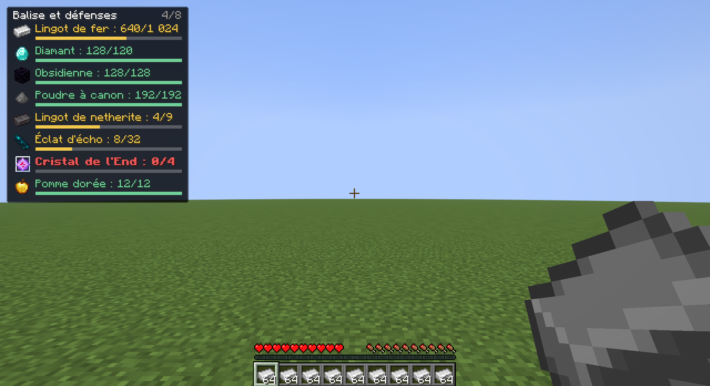
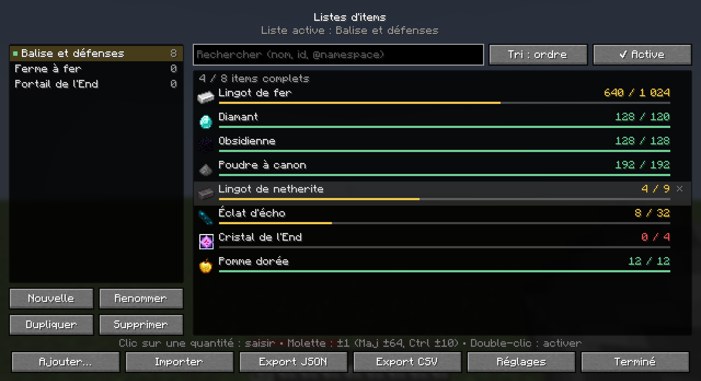
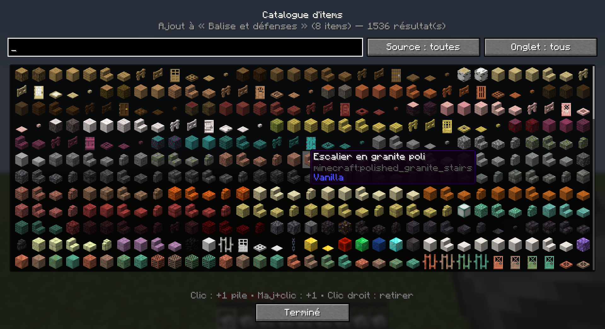
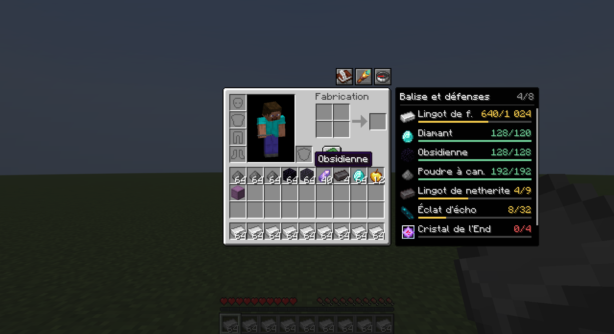
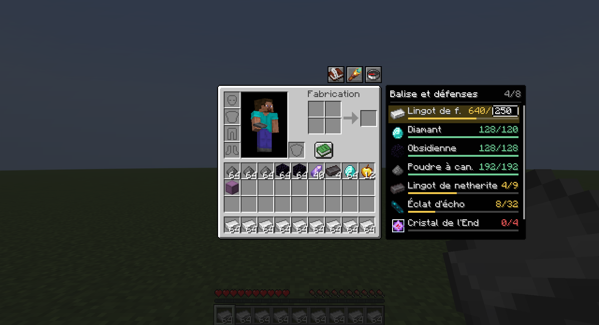
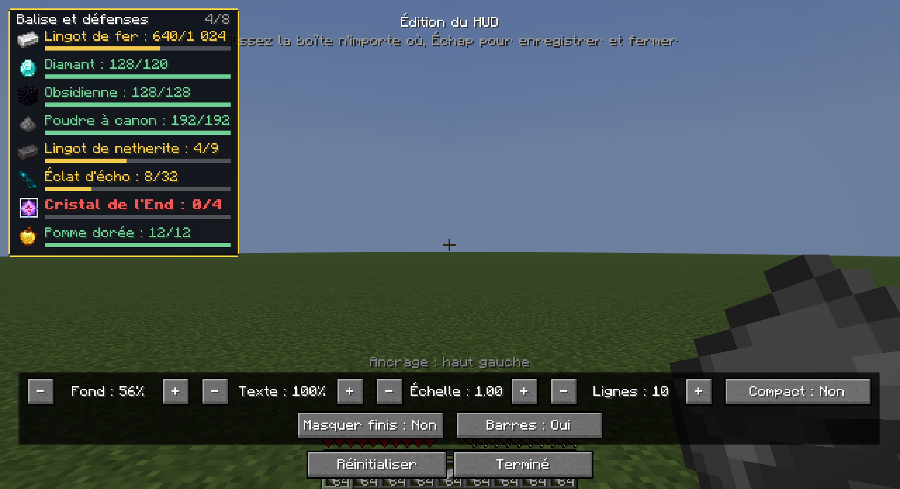

# Item Lists

Mod **Fabric 26.2**, **100 % client**, pour créer et suivre des listes d'items (objectifs de farm, projets de construction, recettes de plugins…), compatible avec les items custom de **Nexo**, **ItemsAdder**, **Oraxen** (et MythicMobs / MMOItems / plugins Bukkit génériques).

- Aucune installation côté serveur. Mis par erreur sur un serveur dédié, il est simplement ignoré (`"environment": "client"`).
- Dépendances : Fabric Loader ≥ 0.19.5, Fabric API, Java 25.
- Optionnel : REI ou JEI (intégration automatique s'ils sont présents).

📖 **Fonctionnement détaillé** (reconnaissance des items custom, comptage, fichiers, architecture, dépannage) : [docs/FONCTIONNEMENT.md](docs/FONCTIONNEMENT.md)



## Installation

1. Installer Fabric Loader pour Minecraft 26.2 et Fabric API.
2. Télécharger `itemlists-x.y.z.jar` depuis les [releases](https://github.com/Eldrazy-Git/Item_lists/releases) et le copier dans le dossier `mods/`.

Nouveautés de chaque version : [CHANGELOG.md](CHANGELOG.md).

## Fonctionnalités

### Listes
- Créer, renommer, dupliquer, supprimer des listes ; une **liste active** suivie par le HUD et le panneau latéral.
- Chaque entrée : identifiant d'item (vanilla ou custom), libellé, quantité cible.
- Sauvegarde automatique dans `config/itemlists/lists/<id>.json` (une liste = un fichier).
- L'`id` d'une liste suit son nom : ASCII minuscule, chiffres et `_`, sans accents ni caractères spéciaux (`Balise et défenses` → `balise_et_defenses`), suffixe `_2`, `_3`… en cas de doublon. Renommer la liste renomme le fichier.

### Menu des listes (touche `Y`, ou `/itemlists open`)
- Listes à gauche (double-clic = activer), contenu à droite : icône, nom, possédé / cible coloré, barre de progression.
- Quantités : clic sur le nombre pour le saisir, molette ±1 (Maj ±64, Ctrl ±10). `×` en fin de ligne pour retirer.
- Recherche (nom, id, `@namespace`), tri (ordre, nom, progression, manquants, quantité).
- Import / export JSON et CSV, réglages.



### Catalogue (« Ajouter… »)
- Tous les items vanilla + les **items custom découverts** sur le serveur courant.
- Recherche `nom`, `id` ou `@nexo`, filtres par source (vanilla, custom, Nexo, ItemsAdder, Oraxen, autre) et par onglet créatif.
- Clic : +1 pile · Maj+clic : +1 · clic droit : retirer.



### Inventaires et conteneurs
Dans l'inventaire et **tous** les écrans de conteneur (coffres, shulkers, ender chest, barils, menus de plugins…) :
- bouton **livre** : menu des listes ; bouton **longue-vue** : afficher/masquer le panneau de la liste active ; bouton **boussole** : position du panneau (auto, gauche, droite, dessous) ;
- **quantités modifiables directement dans le panneau** : clic sur un item puis saisie au clavier (Entrée pour valider, Échap pour annuler, ↑/↓ ±1), ou molette sur la quantité (±1, Maj ±64, Ctrl ±10) ;
- touche `N` sur un item survolé (inventaire, liste et favoris de REI/JEI) : ajout à la liste active. En jeu sans menu, `N` ajoute l'item tenu en main ;
- en position auto, le panneau se place à l'opposé de la liste d'items de REI/JEI (à droite sans eux), en évitant le livre de recettes. En position « dessous », il s'étale sur plusieurs colonnes sous l'inventaire (retour sur le côté s'il manque de place).

| Panneau de la liste active | Quantité en cours de saisie dans le panneau |
|---|---|
|  |  |

### HUD (touche `H` pour afficher/masquer, `/itemlists hud` pour l'éditer)
- Même style que *chunklimitcounter* : panneau sombre aux coins rabotés, palette vert / jaune / rouge (complet / partiel / manquant), barre de progression fine.
- Comptage en temps réel (recalculé seulement quand l'inventaire change) : inventaire, item au curseur, contenu **récursif** des shulkers (`minecraft:container`) et bundles (`minecraft:bundle_contents`). Option : compter le coffre, baril ou shulker ouvert (les menus de plugins, eux, ne sont jamais comptés).
- Éditeur : glisser-déposer n'importe où, ancrage automatique sur le point le plus proche (4 coins, 4 bords, centre), échelle, opacité du fond et du texte, nombre de lignes, mode compact, masquer les items complétés, barres on/off.
- Le HUD se masque sous les menus (le panneau latéral prend le relais dans les inventaires).



### Touches (Options › Commandes › Item Lists)
| Action | Défaut |
|---|---|
| Ouvrir le menu des listes | `Y` |
| Afficher/masquer le HUD | `H` |
| Ajouter l'item survolé à la liste active | `N` |
| Éditer le HUD | non assignée |
| Panneau latéral (inventaires) | non assignée |

Les touches par défaut évitent celles de Minecraft (O, P, L, G, C, X, chiffres…), de chunklimitcounter (K, J, L) et de REI/JEI dans les inventaires (R, U, A, Ctrl+O, Ctrl+F).

## Items custom (Nexo, ItemsAdder, Oraxen…)

Les items custom sont des items vanilla portant des data components. Des **extracteurs d'identité** les reconnaissent, dans cet ordre :

| Extracteur | Où est lue l'identité | Id écrit dans la liste |
|---|---|---|
| nexo | `custom_data.PublicBukkitValues."nexo:id"` | `nexo:<id>` |
| oraxen | `custom_data.PublicBukkitValues."oraxen:id"` | `oraxen:<id>` |
| itemsadder | `custom_data.itemsadder.{namespace,id}` | `<namespace>:<id>` |
| mythicmobs | `custom_data.PublicBukkitValues."mythicmobs:type"` (ou l'ancien `MYTHIC_TYPE`) | `mythicmobs:<type>` |
| mmoitems | `custom_data.MMOITEMS_ITEM_TYPE` + `MMOITEMS_ITEM_ID` | `mmoitems:<type>/<id>` |
| bukkit | toute clé texte `PublicBukkitValues."<plugin>:id"` | `<plugin>:<valeur>` |
| item_model | `minecraft:item_model` différent du modèle vanilla | l'id du modèle (ex. `pack:ruby`), ou `minecraft:paper#diamond` si c'est un modèle vanilla |
| custom_model_data | `minecraft:custom_model_data` | `minecraft:paper#10001` |
| custom_name | nom custom **non italique** (posé par un plugin) | `minecraft:paper#nom_slug` |
| vanilla | sinon | `minecraft:diamond` |

- Le **comptage** compare ces identités : un rubis Nexo n'est pas compté comme du papier, et un diamant renommé à l'enclume reste un diamant.
- Les blocs custom (note blocks, tripwire, champignons…) sont gérés via leur forme item.
- Le client ne connaît pas le registre des plugins : chaque item de plugin d'items vu dans l'**inventaire** ou un **vrai coffre** est mémorisé, **par adresse de serveur**, dans `config/itemlists/custom_items_cache.json`, avec un exemplaire complet de l'item pour afficher son vrai modèle. Les **icônes des menus de plugins** (Retour, Fermer, récompenses…), même quand ce sont des items Nexo, sont ignorées. Option *Découvrir aussi dans les menus* pour `/nexo inventory`.

> ⚠️ Les clés ci-dessus correspondent aux versions publiques des plugins. **Vérifiez-les sur vos vrais items** avec `/itemlists dump` (item en main) ou `/itemlists dump inventory` : la commande affiche l'identité reconnue, l'extracteur utilisé et écrit tous les composants dans `config/itemlists/dumps/`. Si un plugin range son id ailleurs, un nouvel extracteur s'ajoute en une ligne dans `IdentityRegistry`.

## Formats de fichiers

### JSON (export, import et fichiers de `config/itemlists/lists/`)
```json
{
  "id": "balise_et_defenses",
  "label": "Balise et défenses",
  "entries": [
    {
      "item": "minecraft:iron_ingot",
      "label": "Lingot de fer",
      "target": 1024
    },
    {
      "item": "minecraft:diamond",
      "label": "Diamant",
      "target": 120
    },
    {
      "item": "minecraft:echo_shard",
      "label": "Éclat d'écho",
      "target": 32
    }
  ]
}
```
- Écriture : clés dans cet ordre, indentation 2 espaces, fins de ligne LF, UTF-8 sans BOM, caractères accentués écrits tels quels.
- Lecture tolérante : apostrophes simples (`'label'`), commentaires, virgules finales, BOM, `target` en texte (`"12"`). Une entrée invalide est ignorée avec un avertissement, un fichier illisible donne un message d'erreur clair (jamais de crash) et n'est jamais écrasé.

### CSV (pour Excel FR)
```
id;nom;quantite_cible;source
minecraft:iron_ingot;Lingot de fer;1024;vanilla
minecraft:diamond;Diamant;120;vanilla
minecraft:echo_shard;Éclat d'écho;32;vanilla
```
- Export : séparateur `;`, UTF-8 **avec BOM**, fins de ligne CRLF, champs entre guillemets si nécessaire, protection contre l'injection de formules (`=…` → `'=…`).
- `source` : `vanilla`, `nexo`, `itemsadder`, `oraxen` ou `autre`. Pour un item custom, la colonne `id` contient l'identifiant du plugin (ex. `nexo:<id>`, voir [Items custom](#items-custom-nexo-itemsadder-oraxen)).
- Import : séparateur `;`, `,` ou tabulation détecté automatiquement, en-tête facultatif (colonnes reconnues dans n'importe quel ordre : `id`/`item`, `nom`/`name`/`label`, `quantite_cible`/`quantite`/`target`), UTF-8 ou Windows-1252 (CSV enregistré par Excel), nombres du type `3 072`. Le nom de la liste est le nom du fichier.

### Import / export en jeu
- **Importer** : « Choisir un fichier… » ouvre le sélecteur natif du système. En secours, les fichiers déposés dans `config/itemlists/import/` sont listés et importables d'un clic. Une liste importée n'écrase jamais une liste existante (suffixe « (2) »).
- **Exporter** : écrit dans `config/itemlists/export/`, ouvre le dossier et copie le chemin du fichier dans le presse-papiers.

## Compatibilité REI / JEI / EMI

| Mod | Version 26.2 | Intégration |
|---|---|---|
| REI | 26.2.821 | ✅ zones d'exclusion, panneau placé à l'opposé de sa liste, touche `N` sur l'item survolé (liste et favoris), glisser-déposer **depuis ses favoris** vers le panneau latéral |
| JEI | 30.42.0.237 | ✅ zones d'exclusion, panneau placé à l'opposé de sa liste, touche `N` (liste et favoris), glisser-déposer depuis sa liste (ingrédient « fantôme ») |
| EMI | **aucune version 26.x** | ❌ désactivée (EMI s'arrête à 1.21.1) |

REI et JEI n'affichent leur panneau que dans les écrans de conteneur : le glisser-déposer se fait donc vers le **panneau latéral** de l'inventaire. REI ne permet pas de faire glisser les items de sa liste principale (seulement ses favoris et les écrans de recette) : utilisez la touche `N`, ou ajoutez l'item aux favoris REI (`A`) puis glissez-le.

## Fichiers
```
config/itemlists/
├── config.json                 réglages (HUD, boutons, liste active…)
├── lists/<id>.json             une liste par fichier
├── custom_items_cache.json     items custom découverts, par serveur
├── import/                     dépôt de fichiers à importer
├── export/                     exports JSON / CSV
└── dumps/                      rapports de /itemlists dump
```

## Limites connues
- Pour un item vanilla, l'identité est l'item lui-même : toutes les potions comptent comme `minecraft:potion`, les livres enchantés comme `minecraft:enchanted_book`.
- L'opacité du texte du HUD ne s'applique pas aux icônes d'items (Minecraft les dessine toujours opaques).
- Le sélecteur de fichier natif peut s'ouvrir derrière le jeu en plein écran : le dossier `import/` reste disponible.

## Développement
```bash
./gradlew build                      # compile + tests unitaires (JSON, CSV, comptage récursif…)
./gradlew runClient                  # client de dev
./gradlew runClient -Pviewer=rei     # avec REI (ou -Pviewer=jei)
./gradlew runClientGameTest          # tests en jeu automatisés + captures (build/run/clientGameTest/screenshots)
```
Java 25 est requis pour Gradle et Loom. Si `JAVA_HOME` pointe vers une version plus ancienne, lancez par exemple `JAVA_HOME="C:/Program Files/Eclipse Adoptium/jdk-25.0.3.9-hotspot" ./gradlew build`.

Organisation du code (`com.eldrazy.itemlists`) :
- `data` : modèles, listes, cache des items custom.
- `io` : import / export JSON et CSV.
- `identity` : extracteurs par plugin.
- `inventory` : comptage récursif.
- `client.gui` : écrans.
- `client.hud` : HUD.
- `client.inventory` : boutons et panneau des conteneurs.
- `compat.rei` et `compat.jei` : intégrations.
- `config` : réglages.
