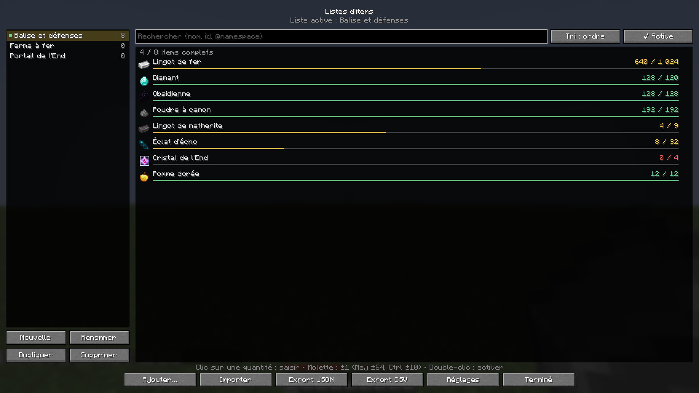
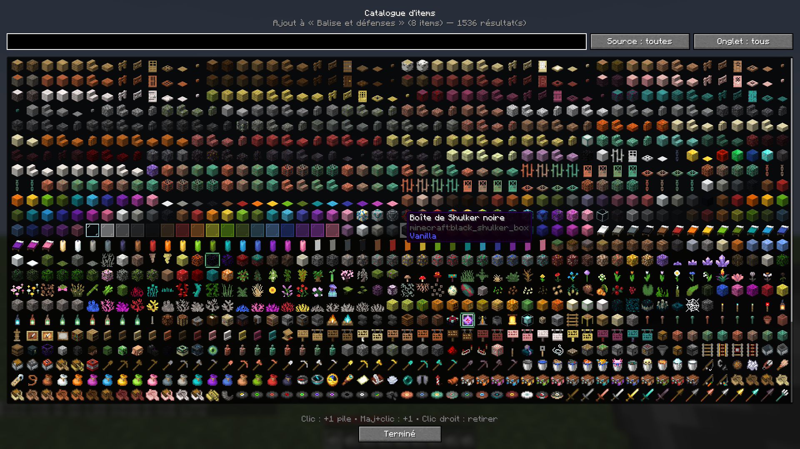
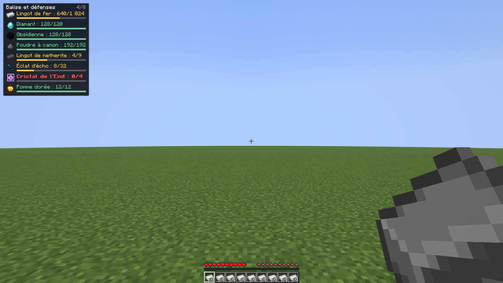
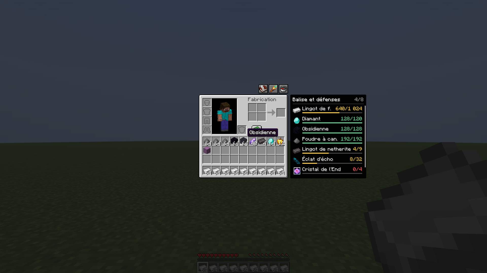
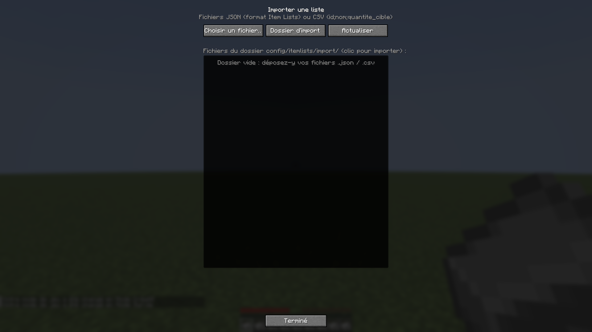
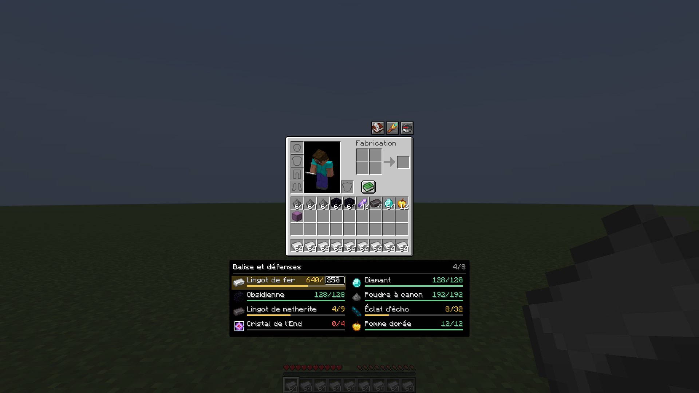
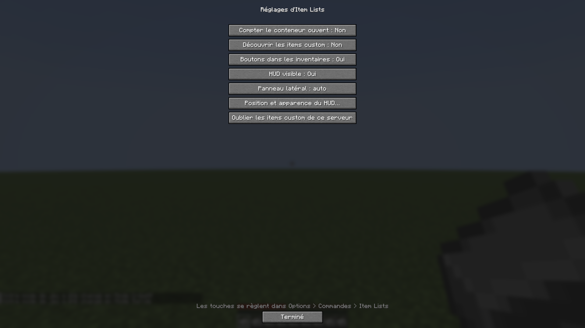

# Fonctionnement d'Item Lists

Ce document explique **comment le mod fonctionne** : ce qui se passe quand vous jouez, comment il reconnaît les items custom, comment il compte, où il enregistre tout, et comment le code est organisé.

- Pour **installer** le mod, découvrir ses fonctionnalités et le détail des formats de fichiers, voir le [README](../README.md).
- Pour **comprendre le fonctionnement** ou **contribuer**, c'est ici.

Sommaire :
1. [Vue d'ensemble](#1-vue-densemble)
2. [Utilisation pas à pas](#2-utilisation-pas-à-pas)
3. [Reconnaissance des items custom](#3-reconnaissance-des-items-custom)
4. [Comptage des items possédés](#4-comptage-des-items-possédés)
5. [Les listes et leurs fichiers](#5-les-listes-et-leurs-fichiers)
6. [Import et export](#6-import-et-export)
7. [Interface : HUD, menus, inventaires](#7-interface--hud-menus-inventaires)
8. [Intégrations REI et JEI](#8-intégrations-rei-et-jei)
9. [Performances](#9-performances)
10. [Architecture du code](#10-architecture-du-code)
11. [Ajouter la prise en charge d'un plugin](#11-ajouter-la-prise-en-charge-dun-plugin)
12. [Compiler et tester](#12-compiler-et-tester)
13. [Dépannage](#13-dépannage)

---

## 1. Vue d'ensemble

Item Lists est un mod **uniquement client** pour Fabric 26.2. Il permet de préparer des listes d'items à réunir (« 1 024 lingots de fer, 120 diamants, 32 éclats d'écho… ») et d'afficher en permanence ce qu'il vous manque.

Comme le mod est uniquement côté client :
- le serveur n'a besoin de rien. Le mod fonctionne sur n'importe quel serveur, y compris ceux qui utilisent Nexo, ItemsAdder ou Oraxen ;
- le mod ne voit que ce que le serveur envoie au client : votre inventaire, les conteneurs que vous ouvrez, les menus des plugins. Il ne peut pas interroger le registre d'items d'un plugin. Il **apprend** donc les items custom au fur et à mesure qu'ils passent sous vos yeux (voir [§3](#3-reconnaissance-des-items-custom)).

Le cycle général :

```
 inventaire / conteneur ouvert
            │  (à chaque tick : empreinte légère des slots)
            ▼
   changement détecté ? ──non──► rien à faire
            │ oui
            ▼
 comptage récursif (shulkers, bundles)  ──►  découverte des items custom (cache par serveur)
            │
            ▼
 quantités par identité  ──►  HUD, panneau latéral, menu des listes
```

---

## 2. Utilisation pas à pas

1. **Créer une liste** : touche `Y` (ou `/itemlists open`) puis **Nouvelle**. Si aucune liste n'est active, la première créée le devient automatiquement.
2. **Ajouter des items**, au choix :
   - bouton **Ajouter…** : ouvre le catalogue. Clic = +1 pile, Maj+clic = +1, clic droit = retirer ;
   - dans n'importe quel inventaire : survoler un item et appuyer sur `N` ;
   - en jeu : tenir l'item en main et appuyer sur `N` ;
   - depuis REI/JEI : survoler un item de leur panneau puis `N`, ou le glisser sur le panneau latéral (favoris REI, liste JEI).
3. **Régler les quantités** dans le menu ou **directement dans le panneau de l'inventaire** : clic sur l'item (panneau) ou sur le nombre (menu) pour le saisir, ou molette sur la quantité (±1, Maj ±64, Ctrl ±10).
4. **Suivre** : la liste active s'affiche dans le HUD. Dans les inventaires, le bouton longue-vue ouvre un panneau latéral avec la même liste.
5. **Partager** : Export JSON ou CSV. Le dossier s'ouvre et le chemin du fichier est copié dans le presse-papiers.

| Menu des listes | Catalogue |
|---|---|
|  |  |

| HUD | Panneau latéral dans l'inventaire |
|---|---|
|  |  |

---

## 3. Reconnaissance des items custom

### Le problème

Pour le client, un « Rubis » Nexo est un simple `minecraft:paper` (ou autre item de base) auquel le serveur a ajouté des **data components** : un modèle (`item_model`), un nom, et surtout des données privées du plugin dans `minecraft:custom_data`. Il faut donc retrouver l'identifiant réel du plugin dans ces composants.

### Les extracteurs d'identité

Chaque stack passe par une chaîne d'**extracteurs** ([`IdentityRegistry`](../src/main/java/com/eldrazy/itemlists/identity/IdentityRegistry.java)), interrogés dans l'ordre. Le premier qui reconnaît l'item donne son identité :

| Ordre | Extracteur | Lit | Identité produite |
|---|---|---|---|
| 1 | nexo | `custom_data → PublicBukkitValues → "nexo:id"` | `nexo:ruby` |
| 2 | oraxen | `custom_data → PublicBukkitValues → "oraxen:id"` | `oraxen:ruby` |
| 3 | itemsadder | `custom_data → itemsadder → namespace + id` | `monpack:ruby` |
| 4 | mythicmobs | `custom_data → MYTHIC_TYPE` | `mythicmobs:KingsCrown` |
| 5 | mmoitems | `custom_data → MMOITEMS_ITEM_TYPE + MMOITEMS_ITEM_ID` | `mmoitems:sword/ruby_sword` |
| 6 | bukkit | toute clé texte `PublicBukkitValues → "<plugin>:id"` | `<plugin>:<valeur>` |
| 7 | item_model | modèle différent de celui de l'item de base | `monpack:ruby`, ou `minecraft:paper#diamond` pour un modèle vanilla réutilisé |
| 8 | custom_model_data | `minecraft:custom_model_data` | `minecraft:paper#10001` |
| 9 | custom_name | nom personnalisé explicitement **non italique** | `minecraft:paper#nom_slug` |
| — | vanilla | aucun des précédents | `minecraft:diamond` |

Quelques règles :
- Les plugins Bukkit rangent leurs données persistantes sous `PublicBukkitValues` depuis 1.20.5, d'où les extracteurs 1, 2 et 6.
- Les extracteurs 7 à 9 sont des **replis** pour les plugins inconnus. Ils produisent des identités « synthétiques » (avec `#`) qui restent stables tant que le serveur ne change pas ses items.
- Un modèle vanilla réutilisé (un papier affiché comme un diamant) donne `minecraft:paper#diamond`. Sinon il serait confondu avec un vrai diamant.
- Un objet **renommé à l'enclume** reste vanilla. Minecraft affiche ces noms en italique, alors que les plugins forcent presque toujours `italic: false`, et c'est ce qui permet de les distinguer.
- Un extracteur qui plante est ignoré et ne casse jamais le comptage.

### Vérifier sur un vrai serveur : `/itemlists dump`

Les clés ci-dessus correspondent aux versions publiques des plugins. Pour les confirmer sur vos items :

- `/itemlists dump` : analyse l'item en main. La commande affiche dans le chat l'identité reconnue, sa source et l'extracteur utilisé. L'identité est cliquable pour la copier.
- `/itemlists dump inventory` : analyse tout l'inventaire.

Dans les deux cas, un rapport complet (tous les composants, en SNBT indenté) est écrit dans `config/itemlists/dumps/`.

### La découverte automatique (cache par serveur)

Chaque fois qu'un item custom inconnu passe dans votre inventaire, dans un conteneur ouvert ou dans un **menu de plugin** (`/nexo inventory`, catalogues de boutique…), le mod le mémorise dans `config/itemlists/custom_items_cache.json` :

```json
{
  "version": 1,
  "servers": {
    "play.monserveur.fr": {
      "nexo:ruby": { "source": "nexo", "label": "Rubis", "stack": { "id": "minecraft:paper", "components": { … } } }
    }
  }
}
```

- La clé est l'adresse du serveur (`singleplayer` en solo). Deux serveurs peuvent ainsi avoir un `nexo:ruby` différent.
- Le **stack complet** est conservé, ce qui permet d'afficher le vrai modèle de l'item (via le pack de ressources du serveur) dans le catalogue, les listes et le HUD, même quand vous ne l'avez plus.
- Pour faire le tour des items d'un serveur, il suffit en pratique d'ouvrir son catalogue en jeu (`/nexo inventory`, `/iazip`…).
- Le cache se vide serveur par serveur depuis **Réglages → Oublier les items custom de ce serveur**.

---

## 4. Comptage des items possédés

### Ce qui est compté

- les 41 slots de l'inventaire (sac, hotbar, armure, seconde main) ;
- l'item tenu par le curseur pendant un déplacement (pour éviter les clignotements) ;
- le contenu des **shulker boxes** (`minecraft:container`) et des **bundles** (`minecraft:bundle_contents`), de façon **récursive** : un bundle dans une shulker est compté, et inversement ;
- en option, le conteneur actuellement ouvert.

Le contenu d'un stack de *N* conteneurs identiques compte *N* fois. La profondeur est bornée à 8 niveaux pour se protéger d'items forgés à l'infini, et les totaux saturent au lieu de déborder.

### Comparaison par identité

Deux stacks correspondent s'ils ont la **même identité extraite** (§3), pas seulement le même item de base. Un rubis Nexo n'est donc jamais compté comme du papier, et dix diamants ordinaires plus un diamant renommé font bien 11 diamants.

### Pourquoi « compter le conteneur ouvert » est désactivé par défaut

Les menus des plugins (boutiques, catalogues, menus de craft custom) sont techniquement des coffres. Compter le conteneur ouvert ferait apparaître comme « possédés » les items exposés dans une boutique. L'option se trouve dans les **Réglages** pour ceux qui veulent compter leurs coffres de stockage.

---

## 5. Les listes et leurs fichiers

Chaque liste est un fichier `config/itemlists/lists/<id>.json`, au format exact d'import/export (voir le [README](../README.md#formats-de-fichiers)) :

```json
{
  "id": "balise_et_defenses",
  "label": "Balise et défenses",
  "entries": [
    { "item": "minecraft:iron_ingot", "label": "Lingot de fer", "target": 1024 }
  ]
}
```

### L'id suit le nom

L'`id` est dérivé du `label` par un slug :
- caractères ASCII en minuscules, chiffres et `_` uniquement ;
- accents retirés, y compris les ligatures : `Cœur` → `coeur`, `Straße` → `strasse` ;
- 64 caractères au maximum ;
- noms réservés de Windows évités : `CON` → `con_liste`.

Quand deux listes ont le même nom, la seconde reçoit un suffixe `_2`, `_3`…

Renommer une liste change donc son `id` et le nom de son fichier. Si vous renommez un fichier ou modifiez un `label` hors du jeu, le mod resynchronise tout au démarrage. Il lit d'abord **tous** les fichiers puis renomme, de sorte qu'il n'écrase jamais un fichier qu'il n'a pas encore lu.

### Sauvegarde

- **Automatique**, avec un délai d'une seconde après la dernière modification : le fichier n'est pas réécrit à chaque cran de molette.
- **Atomique** : le mod écrit dans un fichier temporaire, puis le renomme, ce qui évite un fichier à moitié écrit en cas de crash.
- **Forcée** à la déconnexion et à la fermeture du jeu.
- Un fichier illisible est **ignoré, jamais écrasé ni supprimé**. Son nom reste réservé tant qu'il existe.

### Liste active

La liste active est mémorisée dans `config/itemlists/config.json` (`activeListId`). Elle suit les renommages et est désactivée si la liste est supprimée.

---

## 6. Import et export



### Import

- **Choisir un fichier…** ouvre le sélecteur natif du système (LWJGL *tinyfd*, livré avec Minecraft), sur un thread séparé pour ne pas figer le jeu.
- En secours, tout fichier `.json` ou `.csv` déposé dans `config/itemlists/import/` apparaît dans la liste de l'écran et s'importe d'un clic.

Le lecteur **JSON** est volontairement tolérant :
- il accepte les apostrophes simples, les commentaires, les virgules finales, un BOM et les quantités écrites en texte (`"12"`) ;
- un id sans namespace devient `minecraft:` (`diamond` → `minecraft:diamond`).

Le lecteur **CSV** :
- détecte seul le séparateur (`;`, `,` ou tabulation) ;
- accepte un fichier avec ou sans en-tête, avec des colonnes dans n'importe quel ordre ;
- lit l'encodage UTF-8 ou Windows-1252 (CSV « classique » d'Excel FR) et les nombres de la forme `3 072`.

En cas de problème :
- une ligne invalide est **ignorée avec un avertissement**, et les avertissements s'affichent sous la liste des fichiers ;
- un fichier inutilisable donne un **message d'erreur clair**, sans crash ;
- une liste importée **n'écrase jamais** une liste existante : un label déjà pris reçoit un suffixe « (2) ».

### Export

- **JSON** : clés dans l'ordre `id`, `label`, `entries` puis `item`, `label`, `target`, indentation 2 espaces, LF, UTF-8 sans BOM, accents écrits tels quels.
- **CSV** :
  - colonnes `id;nom;quantite_cible;source` ;
  - UTF-8 **avec BOM** et fins de ligne CRLF, pour qu'Excel FR l'ouvre correctement ;
  - les cellules commençant par `=`, `+`, `-` ou `@` sont préfixées d'une apostrophe, pour qu'Excel ne les exécute pas comme des formules.
- La colonne `source` vient du cache des items custom (`nexo`, `itemsadder`…). À défaut, elle est déduite du namespace.
- Les fichiers sont écrits dans `config/itemlists/export/`. Le dossier s'ouvre et le chemin est copié dans le presse-papiers.

---

## 7. Interface : HUD, menus, inventaires

### HUD

Le HUD reprend le style de *chunklimitcounter* :
- un panneau sombre translucide aux coins rabotés d'un pixel ;
- un en-tête avec le nom de la liste et le résumé « complets / total » ;
- puis une ligne par item : icône, « Nom : possédé/cible » et une fine barre de progression.

Couleurs : rouge = rien en stock (en gras), jaune = partiel, vert = complet.

Il est rendu via l'API `HudElementRegistry` de Fabric. Il se masque :
- avec `H` ;
- avec F1 ;
- sous les menus (sauf le chat), le panneau latéral prenant alors le relais.


L'**éditeur** (`/itemlists hud`, Réglages, ou une touche à assigner) affiche un aperçu réel à déplacer à la souris :
- **Ancrage** : au relâchement, le HUD s'ancre au point le plus proche parmi 9 (coins, milieux des bords, centre). Sa position est mémorisée comme un décalage par rapport à ce point, si bien qu'il reste en place quand la fenêtre change de taille, et il est toujours ramené dans l'écran.
- **Réglages** : opacité du fond et du texte, échelle (0,5 à 2), nombre de lignes (« +N autres » au-delà), mode compact (icônes réduites, sans barres), masquage des items complétés, barres on/off.

### Boutons et panneau latéral des inventaires

Le mod se greffe sur **tout** écran de conteneur (`AbstractContainerScreen`) : inventaire, coffres, shulkers, ender chest, barils, menus de plugins. Il passe uniquement par l'API `ScreenEvents` de Fabric, **sans mixin**. Un petit *class tweaker* rend seulement lisibles la position de la fenêtre et le slot survolé.

**Les trois boutons** (livre = menu des listes, longue-vue = afficher/masquer le panneau, boussole = position du panneau : auto → gauche → droite → dessous) sont placés selon l'écran :
- au-dessus de la fenêtre, alignés à droite. Cette zone est libre : le livre de recettes est à gauche, les effets de potion à droite ;
- dans l'inventaire créatif (onglets au-dessus) ou si la fenêtre touche le haut de l'écran, ils passent sur le côté ;
- ils sont repositionnés à chaque image, ce qui suit l'ouverture du livre de recettes ;
- leur décalage est réglable dans `config.json` (`buttonsOffsetX`, `buttonsOffsetY`).

**Le panneau latéral** :
- **position** (bouton boussole ou **Réglages → Panneau latéral**) :
  - *auto* : à l'opposé de la liste d'items de REI/JEI (à droite sans eux) ;
  - *gauche* / *droite* : côté forcé, avec repli de l'autre côté s'il manque de place ; à gauche, il se décale pour ne pas couvrir le livre de recettes ouvert ;
  - *dessous* : sous l'inventaire, sur plusieurs colonnes si la largeur le permet, en laissant libre le bas de l'écran pour les barres de recherche de REI/JEI. S'il manque de place (interface très grande), retour sur le côté ;
- **édition directe** : un clic sur un item ouvre la saisie de son objectif. Pendant la saisie, le clavier est capté (les chiffres ne déclenchent plus l'échange avec la hotbar, `E` ne ferme pas l'inventaire) : Entrée ou un clic ailleurs valide, Échap annule, ↑/↓ ajuste. La molette sur la quantité ajuste directement l'objectif ;
- sa hauteur s'ajuste au contenu, pour laisser de la place à REI/JEI ;
- il défile à la molette, et les infobulles s'affichent sur les icônes ;
- les clics qui le touchent ne sont **jamais** transmis au conteneur, ce qui évite de jeter par erreur l'item tenu au curseur.

Les touches `N` (ajouter l'item survolé) et panneau latéral sont ignorées pendant la saisie dans un champ texte, comme la recherche de l'inventaire créatif.



### Réglages



Pas de Cloth Config ni de Mod Menu : l'écran de réglages est intégré et la configuration est un simple JSON (`config/itemlists/config.json`), comme dans chunklimitcounter.

---

## 8. Intégrations REI et JEI

Les deux intégrations sont **optionnelles**. Le code est compilé contre leurs API mais n'est jamais embarqué : ce sont REI et JEI qui appellent nos *entrypoints* (`rei_client`, `jei_mod_plugin`). Sans eux, ces classes ne sont jamais chargées.

| Fonction | REI | JEI |
|---|---|---|
| Zones d'exclusion (leur panneau évite nos boutons et notre panneau) | `ExclusionZones` | `IGuiContainerHandler.getGuiExtraAreas` |
| Touche `N` sur un item de leur panneau ou de leurs favoris | `REIRuntime.getOverlay()` → liste + favoris | `getIngredientUnderMouse` (liste + favoris) |
| Glisser un item sur notre panneau latéral → ajout à la liste active | `DraggableStackVisitor` (favoris et écrans de recette uniquement : la liste principale de REI n'est pas « glissable ») | `IGhostIngredientHandler` (depuis la liste) |
| Panneau latéral placé à l'opposé de leur liste d'items | `ConfigObject.isLeftHandSidePanel()` | liste toujours à droite → panneau à gauche |

REI et JEI n'affichent leur panneau que dans les écrans de conteneur. Le glisser-déposer cible donc le panneau latéral, pas le menu des listes.

**EMI** n'a pas de version Minecraft 26.x : son intégration est désactivée. **NEI** n'existe pas sur Fabric moderne.

Les intégrations s'appuient sur un point d'extension commun, [`HoveredStacks`](../src/main/java/com/eldrazy/itemlists/client/inventory/HoveredStacks.java) (« quel item est sous la souris ? »). Une future intégration EMI n'aurait qu'à y enregistrer son fournisseur.

---

## 9. Performances

Le mod est conçu pour ne rien coûter quand rien ne change :

- **Détection des changements** : à chaque tick, une empreinte légère est calculée sur une centaine de slots (référence du stack et quantité). Le comptage complet, avec la récursion dans les conteneurs et l'extraction des identités, ne tourne **que si l'empreinte change**. Un filet de sécurité force un recomptage toutes les 5 secondes.
- **HUD et panneau** : leurs lignes sont des caches reconstruits uniquement quand le comptage, la liste, le cache d'items ou la langue changent. Aucun calcul n'est fait à chaque image.
- **Disque** : sauvegardes différées, 1 s pour les listes et 5 s pour le cache d'items custom.
- **Icônes des items custom** : décodées une seule fois puis mises en cache.

---

## 10. Architecture du code

Package racine : `com.eldrazy.itemlists`.

```
ItemListsClient            point d'entrée client : chargement, tick, sauvegardes, enregistrements
config/                    ModConfig, HudConfig, ConfigManager, ModPaths (tous les chemins)
data/                      modèles et persistance
  ItemList, ListEntry        une liste et ses entrées (format de référence)
  ListIds                    slug label → id
  ListManager                CRUD, liste active, sauvegarde différée et atomique
  CustomItemCache            items custom découverts, par serveur
  ItemSource, ItemIds        source (vanilla/nexo/…) et normalisation des ids
io/                        ListJsonCodec, ListCsvCodec, ImportService, ExportService
identity/                  ItemIdentity, IdentityExtractor, IdentityRegistry, CustomDataReaders
inventory/                 RecursiveCounter (pur, testable), McCountableItem, InventoryTracker
client/
  ItemDisplay                id → stack affichable (cache, repli « papier + nom »)
  EntryRows                  lignes filtrées/triées avec quantités (menu + panneau)
  ListActions                ajout/retrait d'items (catalogue, touche U, REI/JEI)
  CatalogData                contenu du catalogue (registre, onglets créatifs, items custom)
  FileDialogs                sélecteur de fichier natif
  ModKeyBindings             touches
  command/                   /itemlists dump | open | hud
  gui/                       écrans (BaseScreen, ListsScreen, CatalogScreen, ImportScreen,
                             SettingsScreen, HudEditScreen, TextPromptScreen, Theme)
  hud/                       ListHudElement, HudLines (cache), HudRenderer, HudLayout (ancrage)
  inventory/                 ContainerOverlay (boutons + panneau), IconButton, HoveredStacks
compat/rei, compat/jei     intégrations optionnelles
```

Principes :
- **La logique pure est séparée de Minecraft** : `ListJsonCodec`, `ListCsvCodec`, `ListIds`, `ListManager`, `RecursiveCounter` et `CustomDataReaders` se testent sans démarrer le jeu.
- **Pas de mixin**. Tout passe par les événements de Fabric API (`ScreenEvents`, `HudElementRegistry`, `ClientCommandRegistrationCallback`, `KeyMappingHelper`…). Seul un class tweaker ([`itemlists.classtweaker`](../src/main/resources/itemlists.classtweaker)) ouvre cinq champs de `AbstractContainerScreen` en lecture.
- **Le style visuel est centralisé** dans [`Theme`](../src/main/java/com/eldrazy/itemlists/client/gui/Theme.java) (palette et primitives de dessin reprises de chunklimitcounter).
- **Les commentaires du code sont en français.**

---

## 11. Ajouter la prise en charge d'un plugin

Si `/itemlists dump` montre qu'un plugin range son identifiant à un endroit non géré :

1. Ajoutez un lecteur pur dans [`CustomDataReaders`](../src/main/java/com/eldrazy/itemlists/identity/CustomDataReaders.java) :
   ```java
   public static String monPluginId(CompoundTag customData) {
       String id = customData.getStringOr("MON_PLUGIN_ID", null);
       return id == null || id.isBlank() ? null : "monplugin:" + id;
   }
   ```
2. Enregistrez-le dans le bloc `static` de [`IdentityRegistry`](../src/main/java/com/eldrazy/itemlists/identity/IdentityRegistry.java) :
   ```java
   register(simple("monplugin", ItemSource.OTHER, CustomDataReaders::monPluginId));
   ```
   `register` insère automatiquement l'extracteur **avant** les replis (item_model, CMD, nom).
3. Ajoutez un cas dans [`CustomDataReadersTest`](../src/test/java/com/eldrazy/itemlists/identity/CustomDataReadersTest.java).

Pour un plugin qui mériterait sa propre source (filtre du catalogue, colonne CSV), ajoutez une valeur à [`ItemSource`](../src/main/java/com/eldrazy/itemlists/data/ItemSource.java) et ses traductions `gui.itemlists.source.*` et `gui.itemlists.catalog.source.*`.

---

## 12. Compiler et tester

Prérequis : **Java 25** (Loom 1.18 l'exige pour lancer Gradle).

```bash
./gradlew build                     # compile + tests unitaires
./gradlew runClient                 # client de développement
./gradlew runClient -Pviewer=rei    # … avec REI (ou -Pviewer=jei)
./gradlew runClientGameTest         # tests en jeu automatisés
```

### Tests unitaires (`src/test`)
- JSON : relecture du fichier de référence (apostrophes simples comprises), sortie **identique octet pour octet** au format de référence, aller-retour stable, entrées invalides, erreurs.
- CSV : format Excel FR (BOM, `;`, CRLF, guillemets, anti-formules), aller-retour, séparateur `,`, colonnes dans le désordre, Windows-1252.
- Slugs, gestionnaire de listes (renommage, suppression, chargement de fichiers « échangés », fichier cassé préservé).
- Comptage récursif shulker ⇄ bundle, conteneurs empilés, profondeur bornée, saturation.
- Lecteurs `custom_data` de Nexo, Oraxen, ItemsAdder, MythicMobs, MMOItems et Bukkit générique.

### Tests en jeu (`src/gametest`, API client gametest de Fabric)
Le test crée un monde, donne de **faux items de plugins** (composants posés par `/give`, comme le ferait un serveur Nexo ou ItemsAdder) et une shulker contenant des diamants et un bundle de rubis Nexo. Il vérifie ensuite :
- les identités ;
- `/itemlists dump` ;
- la sauvegarde ;
- le comptage récursif ;
- la découverte des items custom.

Il capture enfin chaque écran **en anglais puis en français**, dans `build/run/clientGameTest/screenshots/`. Les images de ce document en proviennent.

### Publier une version
1. Mettre à jour `version` dans `gradle.properties`.
2. `./gradlew build`.
3. Le jar est dans `build/libs/itemlists-<version>.jar` (le `-sources.jar` est facultatif).

---

## 13. Dépannage

| Symptôme | Cause probable / solution |
|---|---|
| Un item custom est compté comme du papier | L'extracteur ne trouve pas sa clé : `/itemlists dump` sur l'item, puis voir [§11](#11-ajouter-la-prise-en-charge-dun-plugin). |
| Un item custom n'apparaît pas dans le catalogue | Il n'a jamais été vu sur ce serveur : ouvrez le menu du plugin qui le contient (`/nexo inventory`…) ou prenez-le en main. Vérifiez que **Réglages → Découvrir les items custom** est activé. |
| Une icône custom s'affiche en papier avec un nom | L'exemplaire mémorisé n'a pas pu être relu (item supprimé du serveur, autre version). Revoir l'item en jeu met le cache à jour. |
| Le HUD n'apparaît pas | Aucune liste active (double-clic sur une liste), HUD masqué (`H`), F1, ou un menu ouvert. |
| Les boutons chevauchent ceux d'un autre mod | Ajustez `buttonsOffsetX` / `buttonsOffsetY` dans `config/itemlists/config.json`, ou désactivez-les dans les Réglages. |
| Le sélecteur de fichier ne s'ouvre pas | En plein écran, il peut s'ouvrir derrière le jeu (Alt+Tab). Sinon, déposez le fichier dans `config/itemlists/import/`. |
| « JSON invalide » à l'import | Le message indique la ligne et la colonne. Les apostrophes simples et les virgules finales sont pourtant acceptées. |
| Accents illisibles dans Excel | Utilisez l'export CSV du mod (UTF-8 avec BOM) ; à la réimport, l'encodage Windows-1252 d'Excel est aussi reconnu. |
| Une liste a disparu au démarrage | Son fichier est illisible : il est conservé tel quel dans `config/itemlists/lists/` et l'erreur est dans `logs/latest.log`. |
| `Dependency requires at least JVM runtime version 25` | Gradle tourne avec une version de Java trop ancienne : pointez `JAVA_HOME` vers un JDK 25. |
